# CodeTutor · 编程学习助手（开源版 · 含 Windows 桌面版）

<p align="center">
  
</p>

<p align="center">
  <b>单文件静态站点 · AI 编程教学 · 四档考试级练习 · 学习知识库 · 多格式文档阅读器（含扫描件 OCR）</b><br>
  <sub>Python / C / C++ ｜ 界面 Apple HIG × 贵阳城市意象 ｜ 数据全部留在本机</sub>
</p>

<p align="center">
  <a href="https://code-tutor-site.pages.dev"></a>
  
  
  
  
  
  <a href="https://github.com/Mikecode985/code-tutor-desktop/actions/workflows/ci.yml"></a>
</p>

<p align="center">
  <a href="https://github.com/Mikecode985/code-tutor-desktop/releases/latest"></a>
  &nbsp;
  <a href="https://code-tutor-site.pages.dev"></a>
</p>

<p align="center">
  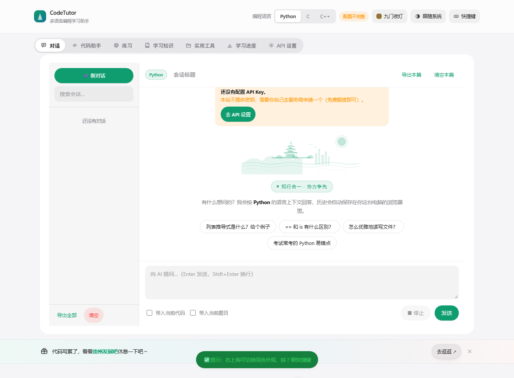
</p>

---

## ✨ 这个项目是什么

本仓库是 CodeTutor 的**开源版本**：既包含可直接部署的**单文件静态网页**（`index.html` 内联全部
HTML/CSS/JS，零构建、零后端），也包含把它打包成 **Windows 桌面软件**（Electron + 一键安装包）的
全部工程与测试。你可以只部署网页，也可以直接构建安装包发给别人用。

- **不需要安装环境**：没有 npm、没有打包步骤，双击 `index.html` 就能用
- **不需要服务器**：静态托管即可（Cloudflare Pages / GitHub Pages / 任意静态空间）
- **不需要别人的 Key**：AI 请求走你自己填的 Key，且可以「浏览器直连服务商」（实测 100~300ms）
- **数据不上传**：对话、进度、掌握度存 `localStorage`；API Key 只在内存里，关页即清

## 🎯 七个面板

| 面板 | 能做什么 |
| --- | --- |
| **对话** | 流式 AI 对话、多轮上下文、历史记录（本地保存）、Markdown 渲染、代码块一键复制 |
| **代码助手** | Bug 诊断 / 代码讲解 / 修复优化 / 易错点，四种任务模板；CodeMirror 编辑器（Python · C · C++） |
| **练习** | **出题 → 作答 → 批改** 三步闭环：按**四档难度规范**（基础 / 计算机二级 / CSP-J / 蓝桥杯国赛级）出题，**出题绝不泄露答案**，批改产出得分环 + 逐项评分 + 漏洞清单 |
| **学习知识** | 四档 × 25 个知识点模块（要点 / 易错点 / 考法 / 语言差异 / 示例代码），标记掌握、一键「练这个知识点」 |
| **实用工具** | **多格式文档阅读器**：Markdown / TXT / PDF / EPUB / DOCX / 代码 / CSV / JSON，多文件列表 + 章节目录 + 原文/AI 提炼双视图 + **导出 Markdown**；**扫描版 PDF 支持 OCR**（AI 视觉 / 本地 Tesseract 双引擎） |
| **学习进度** | 对话轮数、练习次数、批改趋势图、掌握度、导出/导入 JSON 备份 |
| **API 设置** | 服务商与模型、**经代理 / 直连服务商**、视觉模型独立配置、两步自检（含代理身份校验、CORS 预检） |

### 几个用心的地方

- **出题不显示答案**：题目 JSON 契约里根本没有答案字段，答案是批改时由模型独立判断
- **选择题批改带选项**：批改请求会把 A/B/C/D 原文发过去，并禁止模型以"无样例"为由判 0 分
- **OCR 双引擎**：有视觉模型走 AI；DeepSeek / 没配 Key 时自动回落到浏览器内的 Tesseract（不消耗 API），AI 失败还会自动降级
- **按页选择**：`1-3,5,8-10` 表达式 + 页格勾选，OCR 与导出都只处理选中的页
- **9 套贵阳主题**：林城 / 甲秀 / 树谷 / 侗蓝 / 青岩 / 阳明 / 九门 / 三语 / 樱花，默认按季节自动切换，深浅色各自成对
- **UI 遵循 Apple HIG**：系统字体、hairline 分隔线、分组卡片、玻璃拟态、单一强调色、SF Symbols 风格图标（21 个内联 SVG）
- **移动端**：≤760px 自动切换底部标签栏，图表与编辑器都做了触摸适配

## 🚀 下载与安装

四选一，按你的情况挑：

| 你是谁 | 用什么 | 耗时 |
| --- | --- | --- |
| 只想马上试用 | [**在线版**](#方式一在线直接用零安装) | 10 秒 |
| 想要一个桌面软件 | [**Windows 桌面版**](#方式二windows-桌面版推荐日常使用) | 3 分钟 |
| 想改代码 / 学实现 | [**本地打开网页版**](#方式三本地打开网页版改代码或离线用) | 1 分钟 |
| 想给自己/团队部署一套 | [**部署到 Cloudflare Pages**](#方式四部署你自己的站点cloudflare-pages) | 5 分钟 |

---

### 方式一：在线直接用（零安装）

打开 <https://code-tutor-site.pages.dev> → 顶部【API 设置】填自己的 Key → 开始用。

线上版已部署同源代理（`/api/chat`），**访客零配置**，只要能上网就能用，手机/平板也可以。

---

### 方式二：Windows 桌面版（推荐日常使用）

装完就是一个独立软件，**离线也能打开**（只有 AI 请求、PDF、OCR 首次语言包需要联网）。

#### 系统要求

| 项 | 要求 |
| --- | --- |
| 系统 | Windows 10 / 11（64 位） |
| 磁盘 | 约 260 MB（安装后） |
| 权限 | **不需要管理员权限**（装到当前用户目录） |
| 网络 | 仅 AI 功能需要；界面与编辑器离线可用 |

#### 第 1 步：下载

打开 **[Releases](https://github.com/Mikecode985/code-tutor-desktop/releases/latest)**，二选一：

| 文件 | 大小 | 说明 |
| --- | --- | --- |
| **`CodeTutor-1.0.0-win64-setup.zip`** | ≈103 MB | **推荐**：含一键安装脚本，双击就装好（桌面/开始菜单快捷方式 + 卸载入口） |
| `CodeTutor-1.0.0-win64-portable.zip` | ≈103 MB | 绿色免安装：解压后直接双击 `CodeTutor.exe`，不写注册表 |

> **Releases 里还没有资产？** 说明发布者还没上传。你可以用 [Code → Download ZIP](https://github.com/Mikecode985/code-tutor-desktop/archive/refs/heads/main.zip)
> 拿源码，按 [方式五](#方式五自己构建桌面安装包开发者) 自己构建一个（需要 Node.js，约 5 分钟）。

#### 第 2 步：解压

对下载的 zip 右键 → **全部解压缩**（不要直接在压缩包窗口里双击运行，脚本会找不到同级文件）。

解压后目录里应该有这 5 个文件：

```
安装 CodeTutor.cmd      ← 双击这个
install.ps1
CodeTutor-1.0.0-win64.zip
icon.ico
安装说明.txt
```

#### 第 3 步：双击「安装 CodeTutor.cmd」

会弹出一个 PowerShell 窗口，自动完成 6 个步骤（全程约 20 秒）：

1. 关闭正在运行的旧版本
2. 解压到 `%LOCALAPPDATA%\Programs\CodeTutor`
3. 写入图标、卸载脚本、安装说明
4. 创建**桌面快捷方式** + **开始菜单**（程序 / 卸载）
5. 注册到「设置 → 应用 → 已安装的应用」
6. **自动启动**程序

看到绿色的 `✔ 安装完成` 后按回车关闭窗口即可。桌面上会出现「**CodeTutor 编程学习助手**」图标。

#### 第 4 步：第一次配置（约 30 秒）

| 步骤 | 操作 |
| --- | --- |
| 1 | 打开软件 → 顶部 **【API 设置】** |
| 2 | 选服务商（通义千问 / DeepSeek），填**你自己的** API Key |
| 3 | 模型名称：通义千问填 `qwen-plus`，DeepSeek 填 `deepseek-chat`；**视觉模型**填 `qwen-vl-max` |
| 4 | 连接方式选 **「直连服务商（最快）」** |
| 5 | 点 **「测试连接（含代理自检）」**，两步都显示 ✔ 即可 |

#### 装到哪了 / 数据在哪 / 怎么卸载

| 项 | 位置 |
| --- | --- |
| 程序本体 | `%LOCALAPPDATA%\Programs\CodeTutor` |
| 学习数据（对话、进度、掌握度） | `%APPDATA%\CodeTutor` ← **卸载时可选保留** |
| 卸载 | 开始菜单 → CodeTutor → **卸载 CodeTutor 编程学习助手**；或 设置 → 应用 → 找到它点卸载 |
| API Key | 只在运行时内存里，**关闭软件即清除**，不写入任何文件 |

**升级**：下载新版本 → 再双击一次「安装 CodeTutor.cmd」即可覆盖安装，学习数据自动保留。

#### 安装时可能遇到的 4 个问题

<details>
<summary><b>① 提示「Windows 已保护你的电脑」/ SmartScreen 拦截</b></summary>

安装包没有购买代码签名证书，Windows 会警示。点 **「更多信息」→「仍要运行」** 即可。
（本项目是 MIT 开源，全部安装逻辑就在 `desktop/installer/install.ps1` 里，可以自己先审查一遍再运行。）
</details>

<details>
<summary><b>② 双击后窗口一闪而过，或提示「无法加载脚本，因为在此系统上禁止运行脚本」</b></summary>

这是 PowerShell 执行策略（默认 Restricted）在拦脚本。任选一种：

```powershell
# 方式 A：用带 Bypass 的命令跑（不修改系统策略，推荐）
powershell -NoProfile -ExecutionPolicy Bypass -File .\install.ps1

# 方式 B：只为当前用户放开（可随时改回）
Set-ExecutionPolicy -Scope CurrentUser RemoteSigned
```
</details>

<details>
<summary><b>③ 杀毒软件报毒 / 拦截</b></summary>

常见于「未签名 + 会创建快捷方式 + 写注册表」的安装脚本。安装脚本做的事只有：
解压 zip → 复制文件到用户目录 → 用 `WScript.Shell` 建两个快捷方式 → 写 `HKCU` 下一个卸载项 → 启动程序。
全部代码见 `desktop/installer/install.ps1`（190 行），**没有网络请求、没有提权、不碰系统目录**。
确认无误后把该目录加入信任，或改用免安装版（解压双击 `CodeTutor.exe`）。
</details>

<details>
<summary><b>④ 装完双击图标没反应 / 秒退</b></summary>

1. 先确认安装目录里 `CodeTutor.exe` 存在（约 172MB）；
2. 用免安装版 `CodeTutor-1.0.0-win64-portable.zip` 解压后双击 `CodeTutor.exe` 试试，能开说明是快捷方式的问题（重新双击安装脚本即可重建）；
3. 还是打不开：`Win+R` 输入 `%APPDATA%\CodeTutor` 看有没有日志；或在本仓库提 Issue 并附上「设置 → 应用」里显示的版本号。
</details>

#### 下载完整性校验（可选）

<details>
<summary>展开查看 SHA-256（构建于 2026-10-18，v1.0.0）</summary>

```text
3992B6E0CE433394990F1605635A374BB02A34F87C02748D194F216EE4C4C6D3  CodeTutor-1.0.0-win64-setup.zip
CE7EDFBA04F3887F776B48156A0317A4738F457949A11086596A18A27DFAC7C4  CodeTutor-1.0.0-win64-portable.zip
```

校验命令（PowerShell）：

```powershell
Get-FileHash .\CodeTutor-1.0.0-win64-setup.zip -Algorithm SHA256
```
</details>

---

### 方式三：本地打开网页版（改代码或离线用）

```bash
# 1) 拿到源码
git clone https://github.com/Mikecode985/code-tutor-desktop.git
#    或者：GitHub 页面 Code → Download ZIP，解压

# 2) 直接双击 index.html
#    或用任意静态服务器（推荐，避免 file:// 限制）
cd code-tutor-desktop
npx serve .          # 然后打开 http://localhost:3000
```

> ⚠️ 用 `file://` 双击打开时没有同源后端，请到【API 设置】把连接方式切成 **「直连服务商」**。
> 另外 `file://` 下 CodeMirror 从 CDN 加载，**首次需要联网**；桌面版已把编辑器本地化，断网也能用。

---

### 方式四：部署你自己的站点（Cloudflare Pages）

```bash
# 让 Pages 自动识别 functions/ 目录（同源代理，推荐）
npx wrangler pages deploy . --project-name=你的项目名
```

也可以在 Cloudflare 控制台里连这个仓库：构建命令**留空**、输出目录填 `/`。

> 想让别人也能用，请部署**你自己的** `functions/api/chat.js`（别借用别人的代理跑自己的 Key）。
> 也支持自建 Worker（`cloudflare-proxy.js`）与本机代理（`local-proxy.mjs`），见 [docs/DEPLOY.md](docs/DEPLOY.md)。

---

### 方式五：自己构建桌面安装包（开发者）

需要 Node.js 18+ 与 Windows（生成的是 Windows 安装包）：

```powershell
git clone https://github.com/Mikecode985/code-tutor-desktop.git
cd code-tutor-desktop\desktop

npm install            # 首次：Electron + electron-builder，约 400 个包
npm run bundle         # 同步页面 → 打包 → 压缩 → 组装一键安装包
```

产物：

```
desktop/dist/win-unpacked/            免安装版，双击 CodeTutor.exe 即可运行
desktop/dist/一键安装-Windows/        一键安装包（发给别人就发这个文件夹）
  ├─ 安装 CodeTutor.cmd
  ├─ install.ps1
  ├─ CodeTutor-1.0.0-win64.zip
  ├─ icon.ico
  └─ 安装说明.txt
```

想产出**单个 `.exe` 安装器**（而不是 zip + 脚本）也可以：

```powershell
npm run dist     # electron-builder → dist\CodeTutor-Setup-1.0.0.exe（NSIS，oneClick）
# 或：用 NSIS 3 打开 desktop\installer\codetutor.nsi 编译
```

更多细节见 [desktop/README.md](desktop/README.md)。

## 🔑 配置 AI

| 字段 | 建议值 | 说明 |
| --- | --- | --- |
| 服务商 | 通义千问 / DeepSeek | 用哪家就填哪家的 Key |
| 模型名称 | **`qwen-plus`** / `deepseek-chat` | 文本任务（对话、出题、批改、提炼） |
| 视觉模型 | **`qwen-vl-max`** | **只给图片 OCR 用**；留空自动选 |
| 连接方式 | **直连服务商（最快）** | 浏览器直接打服务商；不受 Cloudflare 回源波动影响 |
| 代理地址 | `/api/chat` | 仅在「经代理」模式下需要 |

⚠️ **三个最常见的坑**（都会表现为"AI 不工作"）：

1. **把模型名称填成 VL 模型**（`qwen-vl-max`）→ 出题要输出 7000 tokens，而 VL 上限约 1500 → `400 max_tokens is invalid`。
   正确做法：模型名称用 `qwen-plus`，视觉模型单独填。程序已按模型自动限流兜底。
2. **通义千问"不稳定"** → 多半是 Cloudflare 边缘回源抖动（实测 0.5~20s）。切「直连服务商」即可（实测 96ms）。
3. **选择题批改被判 0 分** → 曾经的 bug（批改没带选项），已修复并加了回归测试。

更多排查见 [docs/TROUBLESHOOTING.md](docs/TROUBLESHOOTING.md)。

## 📸 界面预览

| 对话 | 出题 | 作答 |
| --- | --- | --- |
| 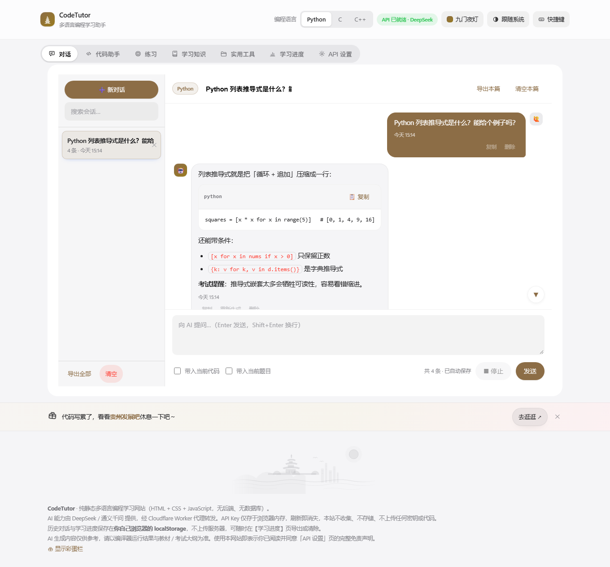 | 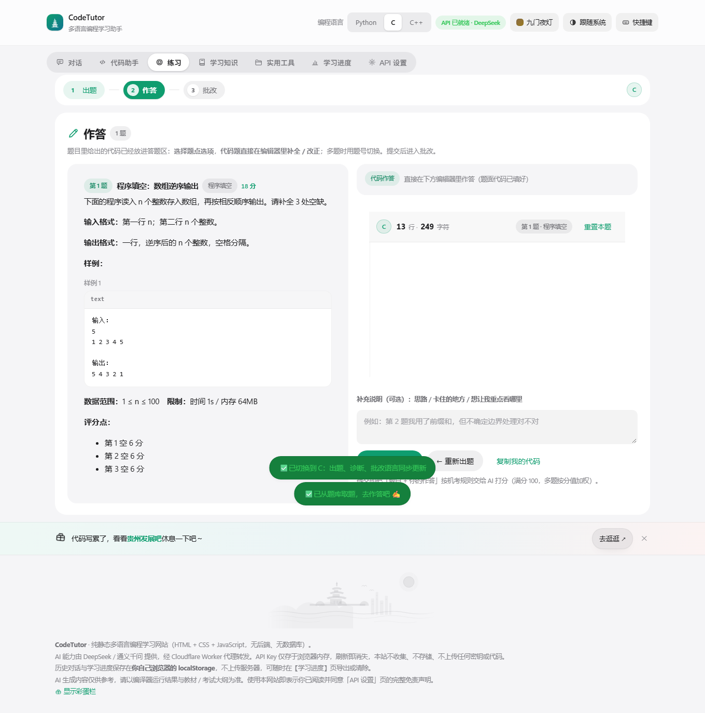 | 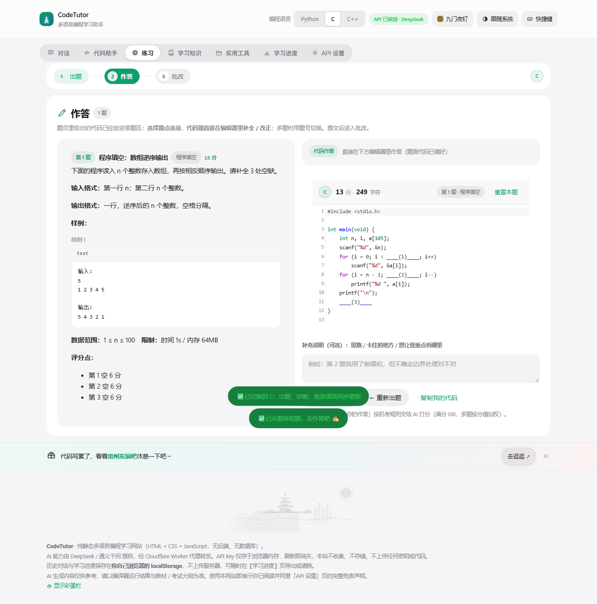 |

| 批改评分 | 学习知识 | 文档阅读器 |
| --- | --- | --- |
| 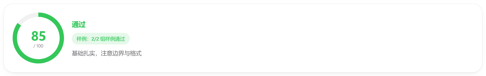 | 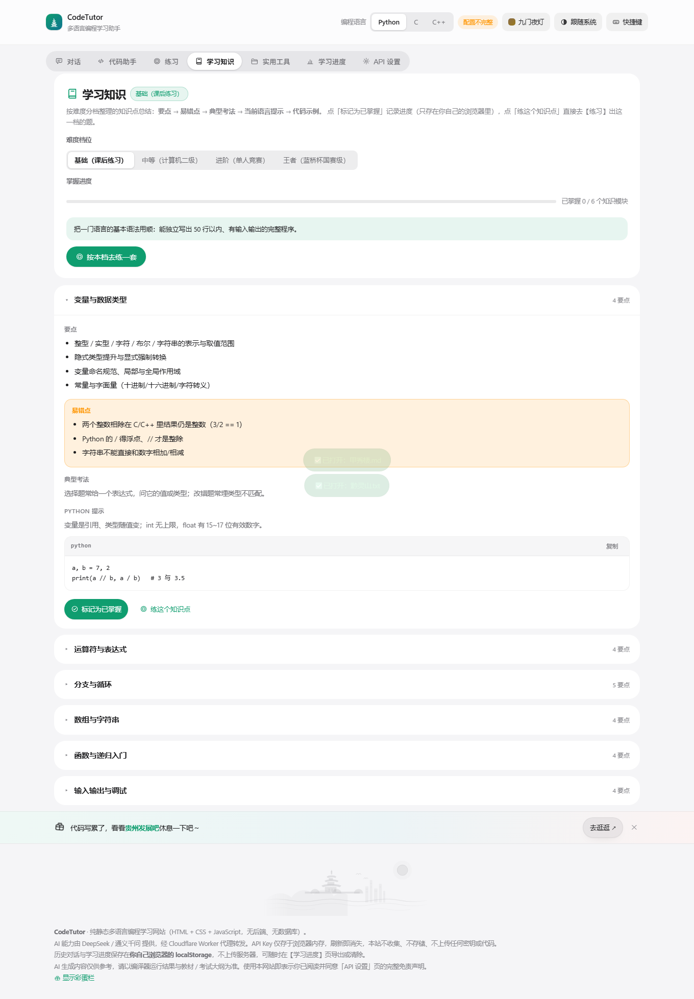 | 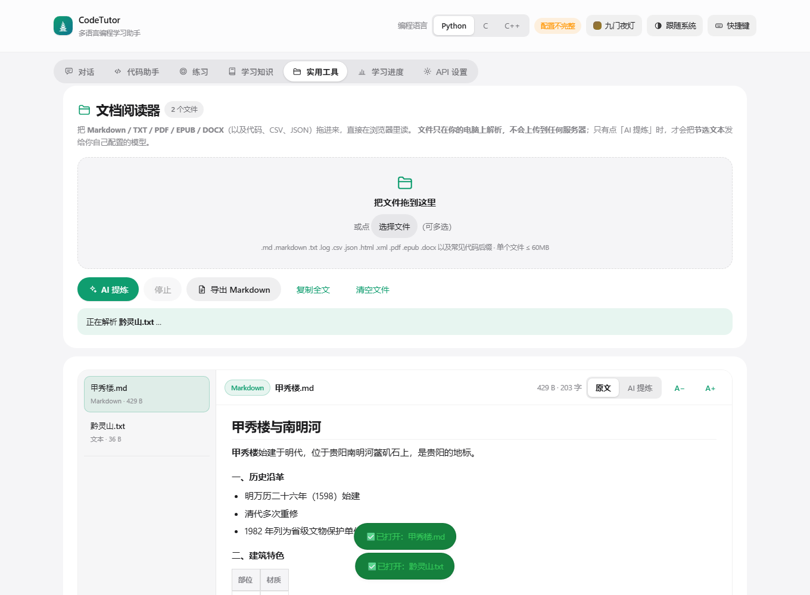 |

| 学习进度 | 深色模式 | 皮肤系统 |
| --- | --- | --- |
| 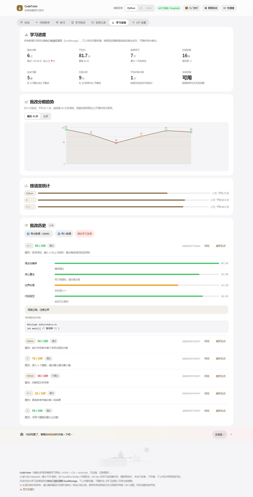 | 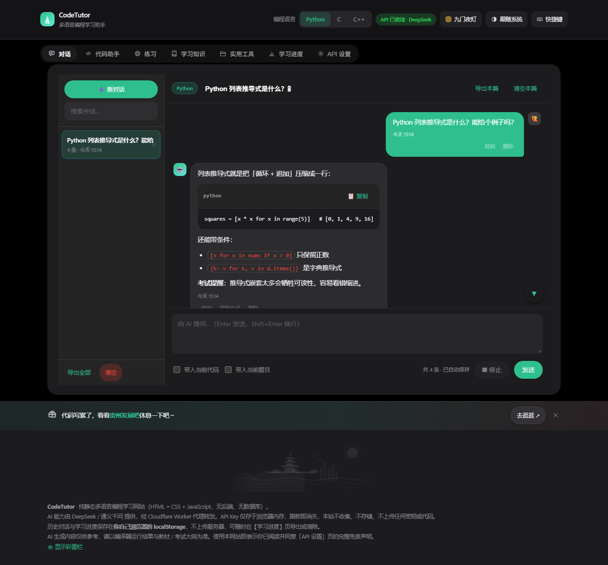 | 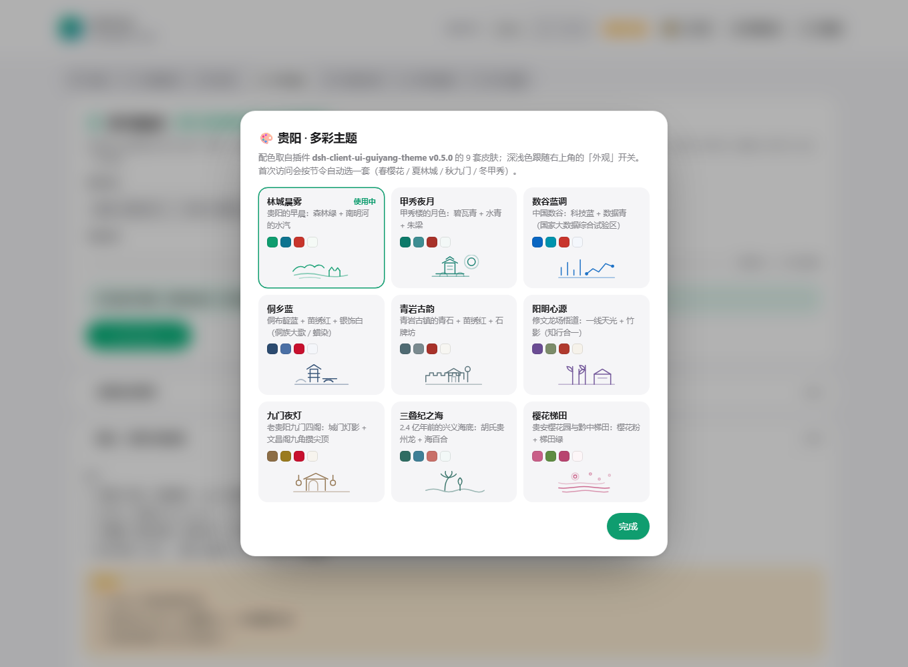 |

<p align="center">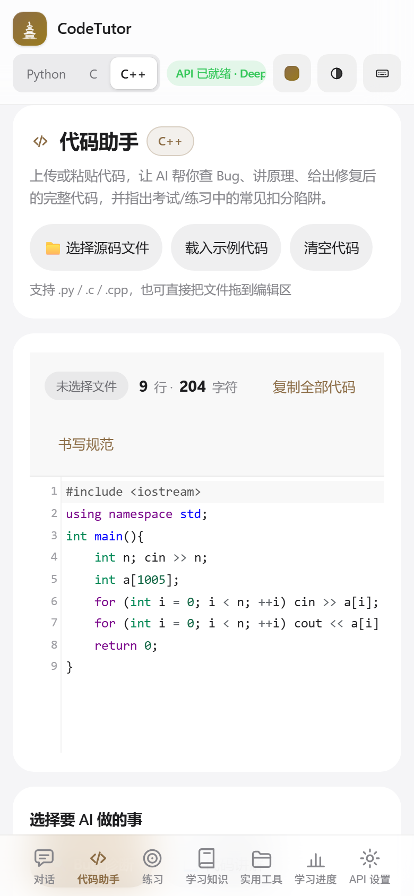</p>

## 🧱 项目结构

```
code-tutor-site/
├─ index.html              应用本体（单文件：HTML + CSS + 全部 JS，约 7000 行）
├─ functions/api/chat.js   Cloudflare Pages Function：同源 AI 代理（推荐）
├─ cloudflare-proxy.js     自建 Worker 版代理（备选）
├─ local-proxy.mjs         本机 Node 代理（http://127.0.0.1:8787，仅自用）
├─ desktop/                Electron 桌面版 + 一键安装包
│  ├─ main.js / preload.js 主进程与预加载（contextIsolation + sandbox）
│  ├─ scripts/sync.js      复制页面并把 CodeMirror 本地化（断网可用）
│  ├─ scripts/make-bundle.js  一条命令产出安装包
│  └─ installer/           安装脚本与 NSIS 脚本
├─ tests/                  10 套自动化测试（476 项断言）
├─ docs/                   架构设计 / 部署 / 故障排查 / 截图
└─ README.md
```

无需安装依赖即可运行；只有跑测试（`jsdom`）和构建桌面版（Electron）需要 `npm install`。

## 🧪 测试：10 套 · 476 项断言

| 套件 | 断言 | 需要 | 覆盖 |
| --- | --- | --- | --- |
| `syntax-check.mjs` | 5 | node | 内联脚本与代理文件的语法 |
| `worker.test.mjs` | 22 | node | Worker 代理：CORS、密钥传递、白名单、错误包装 |
| `alt-deploy.test.mjs` | 28 | node | Pages Function + 本机代理：**多模态 content 原样转发**、429 重试、超时、模型不支持图片的提示 |
| `e2e.mjs` | **137** | jsdom | 前端全链路：七个面板、练习三步、批改解析、知识面板、连接方式、选择题批改 |
| `reader.mjs` | 56 | Chrome | 文档阅读器：真实拖入、手写 EPUB、PDF OCR 与降级、按页选择、隐私 |
| `browser.mjs` | 18 | Chrome | 真实渲染、移动端、长对话滚动回归 |
| `live-verify.mjs` | 39 | Chrome + 线上 | 线上同源代理与真实链路 |
| `feature-audit.mjs` | 109 | Chrome | 全功能完整性审计（A 阶段真实链路 + B 阶段 AI 桩） |
| `desktop-package.mjs` | 45 | node | 桌面版产物：asar 内容、安装包完整、脚本编码 |
| `desktop-page.mjs` | 16 | Chrome | 以 `file://` 加载打包后的页面 |

```bash
cd tests
npm install jsdom        # 仅 e2e 需要
node syntax-check.mjs    # 秒级，随手跑
node worker.test.mjs
node alt-deploy.test.mjs
node e2e.mjs             # 137 项
node desktop-package.mjs # 需要有 desktop/dist 产物
```

GitHub Actions 会自动跑「语法检查 + 代理测试 + e2e」，见 [.github/workflows/ci.yml](.github/workflows/ci.yml)。
需要浏览器与真实网络的套件（audit / reader / browser / live）请在本机跑，用法见 [tests/README.md](tests/README.md)。

## 🔒 隐私与安全

- **API Key**：只存在内存，不写 `localStorage` / Cookie / 服务器；关闭页面即清除
- **学习数据**：`codetutor.*` 前缀存本地浏览器；可在【学习进度】导出 JSON 备份
- **文档阅读器**：文件内容**只在浏览器内存里解析**，刻意不落盘（有自动化断言守住）；只有点「AI 提炼」才会把节选发给你配置的模型
- **OCR**：图片在你本机渲染；本地引擎全程不联网，AI 视觉只发给你的模型
- **桌面版**：`contextIsolation` + `sandbox`，不开 Node 能力给页面，外链一律交给系统浏览器
- **代理**：只转发白名单字段（`model/messages/temperature/max_tokens/stream`），不落盘、不记日志

## 🗺️ Roadmap

- [ ] 文档阅读器：PP-DocLayout 版面分块后逐块 OCR（提升多栏/表格质量）
- [ ] 练习：错题本与按知识点自动组卷
- [ ] 知识库：可导入自己的 Markdown 笔记并与出题联动
- [ ] 桌面版：macOS / Linux 打包
- [ ] i18n：英文界面

## 🤝 贡献

欢迎 Issue 与 PR。提交前请：

1. 跑 `node tests/syntax-check.mjs` 与 `node tests/e2e.mjs`（需 `jsdom`）；
2. 改动界面请附截图；改动逻辑请说明"怎么验证的"；
3. 项目原则：**单文件、零构建、数据本地优先、不引入运行时后端依赖**。

## 📄 License

[MIT](LICENSE) © 2026 Mikecode985

## 🙏 致谢

- 主题设计参考 **dsh-client-ui-guiyang-theme v0.5.0**（贵阳 · 多彩主题）的配色与城市意象
- 扫描件 OCR 的"无 API 兜底"思路借鉴 [universal-reader](https://universal-reader.pages.dev/)
- [CodeMirror 5](https://codemirror.net/5/)、[pdf.js](https://mozilla.github.io/pdf.js/)、[Tesseract.js](https://tesseract.projectnaptha.com/)、[Electron](https://www.electronjs.org/)
- 贵州：甲秀楼、南明河、黔灵山、青岩古镇、阳明心学 —— 「知行合一，协力争先」

---

<p align="center"><sub>如果这个项目帮到你，欢迎点个 ⭐ Star</sub></p>
